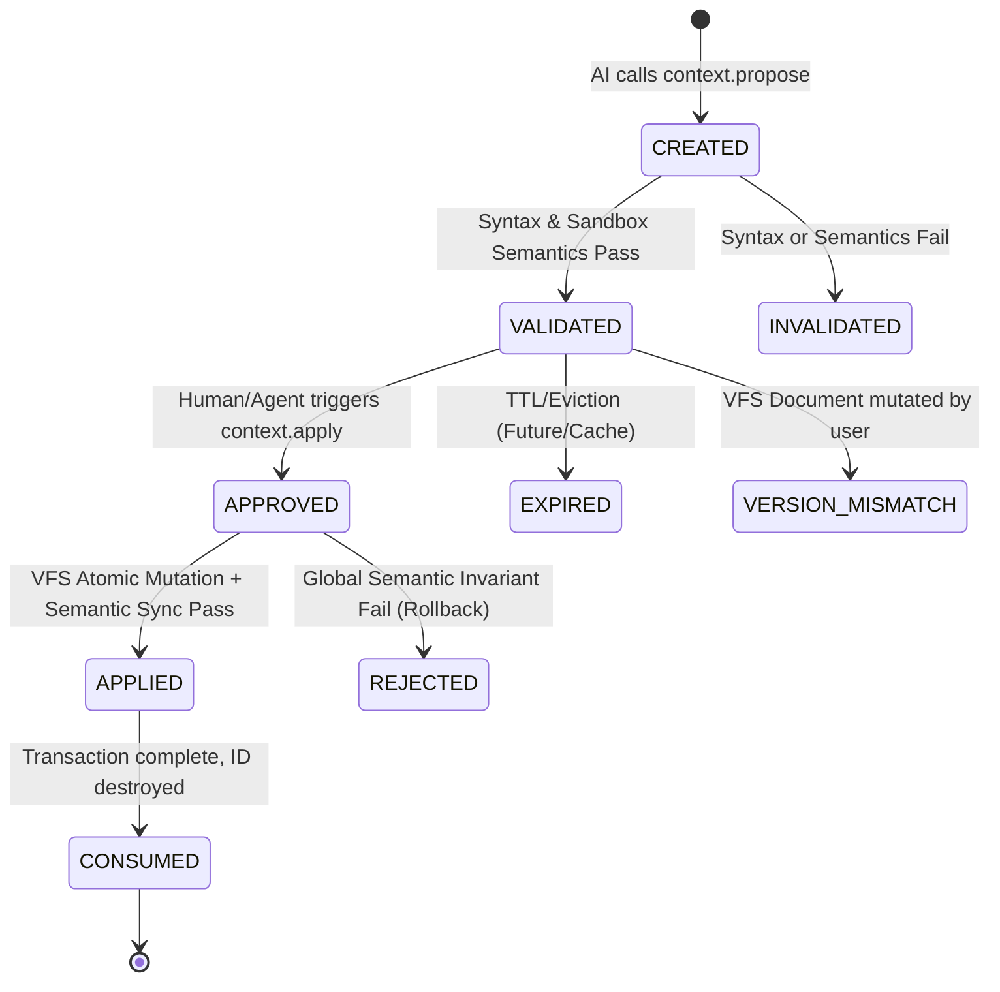

# TinPyUI v1.10: Controlled AI Development Architecture

This document finalizes the **Phase 8** capabilities (Controlled AI Development) and explicitly documents the boundaries, lifecycle states, and structural invariants that must be preserved as TinPyUI progresses into Phase 9 (Hardening & Integration) and beyond.

## 1. Architectural Philosophy

The core architectural boundary of Phase 8 is defined as follows:

> **The AI must consume TinPyUI's deterministic semantic model, and the AI must never become part of the semantic model.**

The pipeline remains entirely unidirectional regarding truth:
1. **TinPyUI** provides deterministic semantic graph traversals (`context.*`).
2. **AI** interprets, searches, and proposes JSON-RPC patches (`context.propose`).
3. **TinPyUI** dry-runs patches in a sandboxed semantic environment.
4. **Human / Agent** approves the patch via explicit protocol command (`context.apply`).
5. **TinPyUI** transactionally applies the patch, strictly verifying global semantic safety, and explicitly rolling back upon failure.

## 2. The Controlled Development Pipeline

The capabilities built across Phase 8 are logically grouped into the **Controlled AI Development** pipeline:

* **8.1 Semantic Context:** Read-only API exposing `ProjectContext`, `FileContext`, and `SymbolContext` from the underlying Semantic Workspace.
* **8.2 Protocol Adapter:** Exposing the AI Context API safely through the `tinpyui://` JSON-RPC Machine Protocol.
* **8.3 Task-Oriented Context:** Higher-level deterministic graph traversals (`context.architecture`, `context.impact`, `context.dependencies`, `context.related`, `context.search`) optimized for LLM consumption.
* **8.4 Proposal & Validation:** AI proposes code changes via `context.propose`. The system enforces expected-version constraints, performs in-memory patching, and validates syntax and semantic constraints *without* mutating global state.
* **8.5 Controlled Apply / Transaction:** The final commit boundary. Transforms a validated `proposal_id` into a globally applied edit, protected by atomic concurrency locks and semantic rollback mechanisms.

## 3. Proposal Lifecycle State Machine

To prevent `context.apply` from inadvertently becoming an unrestricted mutation API in future phases, the system enforces a strict Proposal Lifecycle. Proposals represent hashed, versioned, immutable records of intent.

### Failure Paths (Rollback Triggers)
- **`VALIDATED` → `VERSION_MISMATCH`**: If the target document's `Version` changes between the time the AI proposes the edit and the moment `context.apply` is invoked, the proposal is strictly rejected to prevent race conditions.
- **`APPROVED` → `REJECTED`**: If the applied VFS mutation succeeds, but the subsequent global `syncDocument()` creates a new `UnresolvedReference` (e.g. breaking a cross-file dependency), the VFS mutation is rolled back, the global workspace reverts, and the proposal is marked rejected.

## 4. Preservation of Pre-Phase 8 Constraints

Phase 8 successfully implements Agentic AI features while retaining all prior strict boundaries:
- **No Direct Filesystem Access**: The VFS `UpdateDocumentParams` handles all mutations.
- **No Direct Compiler Execution**: The Execution IR / WASM paths remain fully isolated from the Semantic and AI layers.
- **Race Safety**: The semantic workspace heavily utilizes `RWMutex` to allow concurrent LSP and AI JSON-RPC reads while isolating writes.

## 5. Next Steps

With Phase 8 fully closed, no additional AI capabilities will be injected. 
The system will now proceed to **Phase 9: Architectural Audit & Hardening**, verifying the coherency of the entire v1.10 system (Compiler ↔ Semantic Graph ↔ Workspace ↔ LSP ↔ Machine Protocol ↔ AI Context ↔ Transaction Layer).
